<!-- markdownlint-disable MD033 MD041 -->

  

  

<!-- ================= BATTLE ================= -->

  

<!-- ================= POKÉDEX ENTRY ================= -->
## 📟 Pokédex Entry

<table align="center">
  <tr>
    <td align="center" width="200">
       
      <b>No. 001 · CAMILO</b>
    </td>
    <td>
      <b>Species:</b> Passionate Software Engineer 
      <b>Type:</b> <code>🔥 Backend</code> <code>💧 Frontend</code> <code>🧠 Architecture</code> 
      <b>Ability:</b> Polyglot: learns human <i>and</i> programming languages faster than usual 
      <b>Hidden Ability:</b> Lifelong Learner: never stops leveling up 
      <b>Favorite Item:</b> ☕ Coffee  
      <i>"This Pokémon loves Pokémon, building amazing applications, and learning languages.
      It is often found designing systems late at night."</i>
    </td>
  </tr>
</table>

<!-- ================= MOVESET ================= -->
## ⚔️ Moveset

  

| Type | Moves |
| :--- | :--- |
| 🧠 **Psychic** · Architecture |   |
| 💧 **Water** · Frontend |      |
| 🔥 **Fire** · Backend |      |
| 🌱 **Grass** · Data |   |

<!-- ================= PARTY ================= -->
## 🎒 My Party

<table align="center">
  <tr>
    <td align="center"> <b>Pikachu</b> Ace · Full-stack</td>
    <td align="center"> <b>Gliscor</b> Architecture</td>
    <td align="center"> <b>Electabuzz</b> Backend</td>
    <td align="center"> <b>Dragonite</b> System Design</td>
    <td align="center"> <b>Porygon</b> Polyglot</td>
    <td align="center"> <b>Poliwhirl</b> Frontend</td>
  </tr>
</table>

<!-- ================= CONTACT ================= -->
## 📫 Challenge Me to a Battle!

  
  
  

  

  

